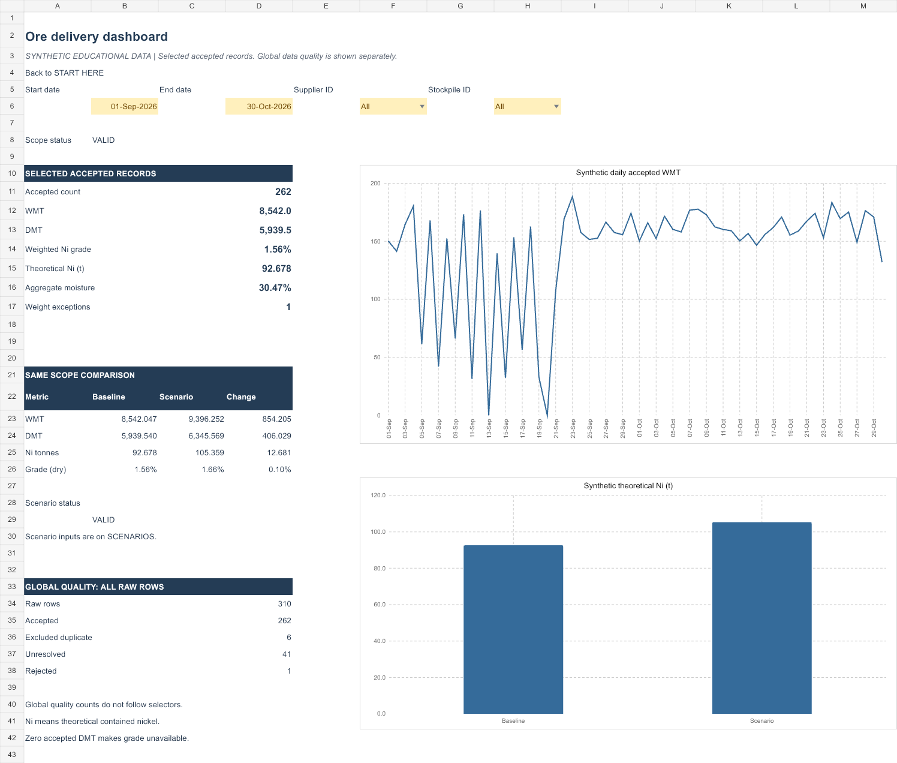

# NickelOps — Ore Delivery Reconciliation and Scenario Analysis

**Ridla A. Gani | Independent portfolio project | SYNTHETIC EDUCATIONAL DATA**

I built NickelOps to explore an operational question: which delivery records can an analyst include, how do supplier and weighbridge weights differ, and how do volume, moisture and nickel-grade assumptions change the result? All suppliers, stockpiles and records are fictional. This is independent portfolio work, not actual mine operations, paid client work, an engineering-approved model or professional mining experience.

The main deliverable is a macro-free Excel 365 workbook with nine sheets, native Excel Tables, exact-match VLOOKUPs, SUMIFS summaries, IF validation gates, conditional formatting and two native charts. **The installed summaries are formula summaries, not PivotTables.** Manual PivotTable steps are below.

## Download and use

[Download NickelOps.xlsx](https://raw.githubusercontent.com/ayilaaldir/nickel-ore-delivery-analysis/main/NickelOps.xlsx) · [Two-page case study](case_study.pdf) · [Complete project release](https://github.com/ayilaaldir/nickel-ore-delivery-analysis/releases/latest)

Normal workbook use is offline. It needs Excel 365, without Python, macros, external workbook links or a cloud account.

1. Open **START HERE**, then **DASHBOARD**. The default scope is 1 September–30 October 2026, all suppliers and all stockpiles. Dashboard **B6/D6/F6/H6** control start date, end date, supplier and stockpile. Selected KPIs and the trend chart share that accepted-record scope; global data-quality counts are labelled separately.
2. Inspect **RAW DELIVERIES** and **DATA REVIEW**. The source snapshot is retained. DATA REVIEW shows original values in AB:AJ, effective values in C:J and inclusion status in B. Do not edit the calculated table.
3. Use the yellow **DATA REVIEW!AQ6:BA46** register to enter a stable `source_row_id`, decision and reason. Corrections require **Approve** and a reason. Approve/Reject require reasons; Hold blocks inclusion. Sort the whole ReviewDecisions Table, never one column. Blank overrides retain the source; zero is an explicit value subject to validation. Enter moisture/grade as fractions, such as **32%** and **1.5%**, not 32 and 1.5.
4. In **SCENARIOS**, B6 is a relative volume change (**10%**), E6 is moisture percentage points (**2**), and H6 is dry-grade percentage points (**0.10**). These add 0.02 and 0.001 to the respective delivery fractions. Invalid assumptions block the scenario with an explanatory status.
5. Check **QA CHECKS** and the [executed test report](test_report.md). Use an editable copy for review/scenario experiments. Worksheet filters change visible rows; dashboard controls determine the reporting scope.



*Preview rendered with artifact-tool. It is not evidence of native Excel UI testing.*

## Dataset and reconciliation

Seed **20260901** generates 300 underlying deliveries over 60 days, four fictional suppliers and three fictional stockpiles. A separate raw snapshot has 310 rows with deliberate identifier noise, unknown suppliers, missing values, invalid fractions, negative weights, exact retransmissions, conflicting delivery IDs and material weight differences. An independent evaluation manifest contains 64 injected-issue entries. Production formulas do not read the manifest or clean ground truth.

Every raw row has a stable source ID. Exact retransmissions retain the smallest source ID; later copies stay visible as excluded duplicates. Conflicting delivery IDs remain blocked until competing submissions receive documented rejections. Mathematical validity always applies, even after approval. Four initial review examples are documented in [data_dictionary.md](data_dictionary.md); other missing measurements are not imputed.

The verified initial population is **310 = 262 accepted + 6 excluded duplicate + 41 unresolved + 1 rejected**. Accepted business IDs are unique.

| Accepted-record metric | Initial snapshot |
|---|---:|
| Weighbridge wet mass | 8,542.047 WMT |
| Dry mass | 5,939.540 DMT |
| Weighted dry-basis nickel grade | 1.5604% |
| Aggregate moisture | 30.4670% |
| Theoretical contained nickel | 92.678336 t |
| Accepted weight-variance exceptions | 1 |

Supplier, stockpile and daily summaries reconcile to the accepted population within **1e-7 tonnes**. The 41 unresolved records remain outside these totals. These are observations from a synthetic review state, not conclusions about supplier performance.

## Metrics and assumptions

The analysis uses weighbridge net WMT. **DMT = WMT × (1 − moisture)** and **theoretical Ni tonnes = DMT × dry-basis grade**. Aggregate grade is total Ni / total DMT; aggregate moisture is 1 − total DMT / total WMT. Percentages are stored as fractions, so 1.5% is 0.015. Percentage fields are never averaged without their appropriate weights. Missing/invalid measurements produce unavailable metrics, not false zeros.

Signed weight variance is weighbridge minus supplier-reported WMT. Percentage variance divides by positive reported WMT. Review flags use its absolute percentage while retaining the sign. The default 3% variance, 40% moisture and 3% dry-grade thresholds are configurable **illustrative assumptions, not industry standards**. They are separate from mathematical fraction bounds [0,1] and positive-weight rules.

The default combined case assumes **+10% relative WMT, +2 moisture pp and +0.10 dry-grade pp**, applied at each scoped accepted delivery before aggregation. It produces **9,396.252 WMT, 6,345.569 DMT and 105.359180 t theoretical Ni**. These are assumptions, not forecasts. One-way sensitivities isolate moisture and grade effects.

Theoretical contained nickel is **not recoverable nickel, payable nickel, revenue or profit**. The project makes no claim of real savings, production gains or deployment.

## Verification and reproduction

**174 recorded checks passed; 0 failed.** Artifact-tool exercised formula mutations and chart-source updates; Python independently recomputed results and openpyxl inspected the saved workbook and cached values. Checks cover row accounting, all manifest entries, missing/invalid inputs, keyed decisions, weighted calculations, summary reconciliation, scenario scaling/directions, percentage-point examples and invalid assumptions. Workbook previews and the two-page PDF were rendered and visually inspected. See [test_report.md](test_report.md) and `reports/` for expected/actual values, tolerances and engines.

**Native Excel UI and Excel-engine recalculation were not tested.** Excel COM activation failed with HRESULT 0x80070520. Native dropdowns, protection interaction, chart redraw and PivotTable creation/refresh remain manual checks. Installed formulas and charts alone do not prove those interactions.

To check the supplied workbook, run `python scripts/verify_calculations.py` from the project root with Python 3.11+ and openpyxl 3.1.5. It does not modify the XLSX; it refreshes CSV exports and verification reports.

A complete rebuild also needs the packages in `requirements.txt`, Node (tested 26.13.0) and an existing **@oai/artifact-tool 2.8.158** installation. Artifact-tool is not bundled or installed by `requirements.txt`; full rebuilding is unavailable without that runtime. Set `NICKELOPS_NODE_MODULES` to its installed node_modules directory when needed. The finished workbook does not depend on that runtime. PDF generation uses ReportLab; validation/rendering uses pypdf and pypdfium2.

Scripts enforce the original folder name. Clone into that name and use project-local temporary/cache directories:

```powershell
git clone https://github.com/ayilaaldir/nickel-ore-delivery-analysis.git NickelOps-Ore-Delivery-Reconciliation-and-Scenario-Analysis
cd NickelOps-Ore-Delivery-Reconciliation-and-Scenario-Analysis
$env:TEMP = Join-Path (Get-Location).ProviderPath 'tmp'
$env:TMP = $env:TEMP
$env:PYTHONPYCACHEPREFIX = Join-Path (Get-Location).ProviderPath 'tmp/cache'
python scripts/generate_data.py
python scripts/build_spec.py
node scripts/build_workbook.mjs
node scripts/test_qa_compatibility.mjs
python scripts/finalize_xlsx.py
node scripts/render_final_dashboard.mjs
python scripts/verify_calculations.py
python scripts/build_documents.py
python scripts/package_project.py
```

Use a project-local environment for any dependency installation. Generation rebuilds the synthetic snapshot and resets the four initial review decisions: save edited work first. Generated `data/workbook_input.json` is an intermediate recreated by generation. CSV exports, case study, PDF and test report are snapshots and do not update with Excel edits. Preserve reviewed inputs in `data/review_decisions.csv` and the corresponding generated workbook input before rebuilding without `generate_data.py`.

## Capacity, refresh and manual Excel checks

The workbook has fixed capacities: **310 source/review/clean/scenario rows, 40 keyed review entries and 60 daily-summary dates**. Appending beyond those ranges is not supported. Regenerate and update capacities/date ranges for a larger dataset. Accepted dates outside the daily-summary horizon trigger a reconciliation failure until the window is extended.

In Excel 365, set Formulas → Calculation Options → Automatic and press F9. Exercise a dashboard selector, keyed decision and scenario input; check the affected outputs/charts, then restore defaults. Native interaction remains unverified until this is done. Initial Python QA controls are delivery-time benchmarks and report REVIEW when the population changes.

To create genuine PivotTables manually:

1. Select **CLEAN DELIVERIES!A6:T316**. Insert → PivotTable → From Table/Range; confirm **CleanDeliveries** and choose Existing Worksheet **SUMMARY!K20**.
2. Filter `inclusion_status` to **Accepted**. Put `supplier_name` in Rows. Put `accepted_flag`, `weighbridge_WMT`, `DMT` and `theoretical_contained_Ni_t` in Values, with every field set to **SUM**. The accepted_flag sum is delivery count.
3. Repeat at **SUMMARY!K35** with `stockpile_name`. For a daily trend use `delivery_date`, ungrouping dates if needed.
4. After input changes, calculate first, then Data → Refresh All. Confirm the Accepted filter. Compare WMT/DMT/Ni grand totals with `SUM(SUMMARY!C7:C10)`, `SUM(SUMMARY!D7:D10)` and `SUM(SUMMARY!E7:E10)`.
5. Outside the Pivot, calculate grade as total Ni / total DMT and moisture as 1 − total DMT / total WMT. Do not use Average of the percentage fields.

No PivotTable is installed, and its creation/refresh has not been tested. These actions require local Excel software, without an additional online account.

## File guide and attribution

- `NickelOps.xlsx`: working workbook; `previews/`: rendered sheets, filtered views and PDF pages.
- `data/`: raw deliveries, fictional reference tables and initial keyed review decisions.
- `evaluation/`: clean ground truth and issue manifest, isolated from production formulas.
- `exports/`: accepted-delivery and summary CSV snapshots labelled synthetic.
- `scripts/`: data generation, workbook creation/finalization, verification, document generation and packaging source.
- `reports/`: saved-artifact, mutation and reproducibility evidence, plus file checksums.
- [Case study](case_study.md), [data dictionary](data_dictionary.md), [test report](test_report.md) and [2–3 minute demo](demo_script.md).

I developed this independent portfolio with AI assistance for code and documentation. I do not claim to have manually written every line or deployed it in mining operations. No repository-wide license has been assigned. Third-party dependencies are not bundled; their original licenses and terms apply.
